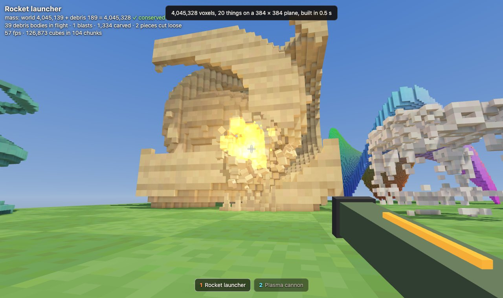

# destroy/: a voxel destruction arena

Asked for 2026-11-21: "a fun voxel destruction arena/playground: there should
be loadable .vdag worlds, specimen, math shapes on a thick flat plane, and you
are a player with a rocket launcher and a plasma cannon. You run around blasting
chunks out of the voxels. The explosions should make debris that have physics
and fall, and when they settle they should bake into the voxels around:
basically mass is preserved in the world."

Serve the repo (`npm run serve`) and open `http://localhost:8000/destroy/`.

## Playing

| | |
|---|---|
| click | play (locks the mouse; Esc lets go) |
| W A S D, space, shift | walk, jump, run (run at a wall to climb it): walk-core's walker, unchanged |
| left mouse | fire (hold for the plasma's stream) |
| right mouse | alt fire: a big rocket (radius × 1.8), or a spread of 7 bolts |
| 1, 2, wheel, Q | rocket launcher, plasma cannon |
| F | fly, no collision (shift faster, space up) |
| T | slow motion (¼) |
| M | sound |
| Tab | the arena's settings |
| R | rebuild the arena |

The settings panel holds the arena's size (256, 384 or 512 across), height,
plane thickness, seed, how many specimens and math shapes, the `.vdag` files
(add with the button or drop them on the page), the two blast radii, whether
loose pieces fall, shadows, sound and mouse speed. They're kept in
localStorage, and any of them can go in the link (`?size=256&seed=7&maths=10`).

The HUD's second line is the point of the thing:
`mass: world 4,045,161 + debris 167 = 4,045,328 ✓ conserved`.

## How it works

Every rule is in a pure core, tested in Node; the page reads input, draws,
plays sounds and moves results between the cores.

| file | what |
|---|---|
| `arena-core.js` | the grid: cells, chunks, the mesh's words, rays, blasts, loose pieces, putting voxels back |
| `debris-core.js` | bodies, their move, the bake, the burst, the push |
| `content-core.js` | the plane, specimens, math shapes, `.vdag` worlds as items, the layout, the build |
| `build-worker.js` | one build off the page's thread (reads the files, calls `buildArena`, posts each thing as it's placed) |
| `index.html` | the page: WebGL2, input, weapons, effects, sound, HUD, panel |
| `../walk-core.js` | the player, the stream viewer's walker, imported unchanged |

### A dense grid, not the DAG

Everything else in the repo keeps a world as a hash-consed DAG, because that's
what lets a D = 20 world fit at all. An arena is the opposite case: a few
hundred voxels a side, edited hundreds of times a second (a rocket carves a
ball, then every piece of rubble writes its voxels back one by one when it
lands). A DAG edit re-interns a path a voxel and moves the root, and the
streamer re-expands every chunk under the change. Here an edit is one store
into a `Uint16Array` and a dirty bit on a 32³ chunk. The DAG is where content
comes *from*: `.vdag` files are walked down to the lod that fits and stamped in.

A cell is 0 for air, else bit 15 set and 5:5:5 RGB (so black is `0x8000`,
never air). The layout is y-major (`x + X·(z + Z·y)`). 384 × 192 × 384 is 28
million cells, 57 MB.

### Mass

`arena.count` is kept exact by `set`. Anything that takes voxels out of the
grid hands them back as a list: `blast` returns what it carved, `detach` what
it lifted. They fly as debris bodies, and `bake` writes every one back. The
only way a voxel leaves for good would be `nearestFree` finding no air in the
whole arena, and then it throws rather than dropping it quietly. Scorch changes
colours, never mass.

The tests hold it: random barrages, run until everything has baked, with the
mass checked after every step, and the *multiset of colours* in world plus
debris the same at the end as before the first shot (scorch off), so voxels
are moved, never made or lost. The page's selftest checks the mass every frame
in the browser too.

### A blast

1. **Carve** (`blast`): every solid cell whose centre is within
   r·(1 − jag/2 + jag·h) of the centre, where h is a hash of the cell's 2³
   block, so the crater's edge is chunky rather than a smooth ball. Bedrock
   (y = 0) is never carved. A shell 1.5 voxels thick past the edge is
   darkened toward char.
2. **Burst** (`burst`): the rocket's voxels are grouped into 2³ clusters (3³
   past 3,000 voxels, so a big rocket is ~400 bodies, not 1,100), each
   thrown out of the face that was hit, away from the centre, upward, with
   a hashed scatter. The plasma's voxels are each a molten drop, coloured
   halfway to slag, glowing, thrown gently off the face.
3. **Loose pieces** (`looseAround`): which solid pieces near the crater now
   hang on nothing? A piece is held if it reaches bedrock through solid
   cells, **26-connected**: corner contacts hold, because the math world's
   sheets and tubes are made of balls, and a 6-connected rule would drop
   half a gyroid at the first shot. Seeds are the solid cells in the
   blast's box with an air face. Each is walked depth first with downward
   neighbours popped first, so a held piece usually finds bedrock in a few
   dozen steps, and meeting a cell another walk labelled ends the walk (a
   loose piece is always walked whole, so anything else a walk meets was
   held). A walk past 60,000 cells counts as held: a cliff too big to fall
   stays up. That's a limit on the work, and the test says so. Loose pieces
   are lifted out whole (`detach`) and fall as one rigid body.
4. **Push** (`pushBodies`): bodies nearby are thrown away from the blast, and
   so is the walker: a rocket at your feet is a rocket jump.

### Debris

A body is a set of voxels moving as one: integer offsets from a float corner,
their colours, a velocity. Bodies hit the grid, not each other.

**The move** is walk-core's, for a set of unit boxes that share one fraction:
each axis on its own (y first), in substeps under 0.45 voxels, testing only
the voxels with no body voxel ahead of them on that axis. A move that meets a
solid cell stops the body flush against it, at an integer on that axis, since
every offset is an integer. So a body is never inside the grid, and a landed
body stands at an integer height.

**At rest** (on the ground, slower than 1.5 voxels a second for 0.12 s, or
older than 9 s, or 5 s for a drop, or pushed out by the cap of 4,000 bodies)
a body **bakes**:
- **whole**, at the nearest integer place (four roundings of x and z, then a
  cell up) where every voxel's cell is free, so a piece keeps its shape;
- **else voxel by voxel**, each to `nearestFree` of its rounded cell (itself,
  else the nearest within 3 cells, the higher of a tie so rubble lands on a
  pile rather than in a cave, else up its column, else wider shells) and
  then `settleDown` (straight down while the cell under it is air; molten
  drops and single grains also slide down open diagonals, sand's 45°).

**Overtaken**: since bodies pass through each other, one that bakes can write
its voxels where another is. After a bake, any body that finds itself inside
the grid bakes at once, voxel by voxel. A last sweep in each step repeats this
until no body is inside, so after `stepDebris` the promise holds for every
body. This is also how rubble piles up: two clusters fall to the same spot,
the first bakes, and the second lands on top of it. Measured on a big rocket
(below), 278 of 400 bodies went this way.

**Molten drops** flow before they bake: on the ground, with an open diagonal
below one side, a drop is nudged that way, so the plasma's melt runs off
ledges and pools.

### Drawing

Raw WebGL2. One instanced cube per exposed voxel, decoded from three uint32
words (`meshChunk`: place in the chunk and face mask; colour and the AO of the
±x faces; the AO of the other four), drawing of each axis's two faces the one
on the eye's side (the stream viewer's "three faces a cube", 18 vertices an
instance). AO is the classic voxel rule, two bits a face corner, and each
quad's diagonal runs along the brighter pair so occlusion doesn't streak.
Chunks are 32³; a dirty one is re-meshed within a 5 ms budget a frame and
culled by the frustum.

A sun shadow map (4096², orthographic round the arena's box) is redrawn when
the world changed, at most 8 times a second; debris and effects get shadows
but don't cast them. Debris, projectiles, sparks, smoke, the fireball and the
gun in hand are a second instanced cube with a turn and a scale per instance.
The gun is drawn after a depth clear, so it never goes into a wall.

### The build streams

A build took 5 to 10 s on some machines, with nothing on screen until the
end (2026-11-23). The time is the worker making things (math shapes are
70–85% of it: `voxelize`), then the page meshing every chunk at once
(0.25–0.65 s here, blocking). Now the arena fills in as it's made:

- At once the page makes the new arena itself, lays the plane
  (`fillPlane`) and looks over it from above the near edge.
- The worker builds no grid. `buildArena(…, { grid: false, onPlace })` hands
  over each thing as soon as it's placed, and the worker posts its cells
  (transferred). The page stamps them (`stampItem`) and accounts for the box
  (arena-core's `refreshBox`: the counts of the chunks it meets, those and
  their neighbours dirty), and the frame re-meshes 10 ms of chunks a frame
  while it builds (5 after).
- `built` brings the count the page's arena must come to (the plane plus
  every placed thing: nothing placed overlaps), and the eye glides down to
  the walker. While it streams nothing is fired or walked, since debris
  baked where a thing then lands would be lost to the mass.

**The layout's order had to change for it.** It used to make every thing,
then place them biggest trimmed footprint first. Placing one as soon as it's
made needs the order before the things exist, so it's now the box each
will have *at most*, known from the plan before the slow part (`mathPlan`'s
R², `specimenPlan`'s (R·scale)²; the test holds every made thing inside its
plan's box). An item's tries are still hashed from its index in the list,
so most things land where they did, but a seed's arena moved a little.

Sound is synthesized in WebAudio (filtered noise and swept oscillators), so
there is nothing to load.

## Measured

M2 Max, Node 22, `node` on the cores (the page's numbers are from headless
Chrome on the GPU at 1280 × 760, where it holds 55–60 fps).

| arena | voxels | build | mesh, all chunks | instances | grid |
|---|---|---|---|---|---|
| 256 × 192 × 256 | 1,971,286 | 541 ms | 149 ms | 226,798 | 25 MB |
| 384 × 192 × 384 (default) | 4,045,328 | 334 ms | 221 ms | 352,944 | 57 MB |
| 512 × 192 × 512 | 6,797,840 | 320 ms | 267 ms | 479,408 | 101 MB |

(The 256 build is slower because the math shapes it draws first are bigger
fractals: the layout's seed walks the deck the same way, and R is hashed
within the room.)

Blasts on the default arena's biggest specimen (a 64³ one, ~25% solid):

| shot | carved | bodies | carve + burst + loose | settled | worst step |
|---|---|---|---|---|---|
| rocket, r 7 | 376 | 75 | 4.4 ms | 3.0 s | 1.1 ms |
| big rocket, r 12.6 | 4,171 | 326 | 16 ms | 2.9 s | 4.1 ms |
| plasma, r 2.5 | 13 | 13 drops | 0.6 ms | 5.0 s (they flow) | 0.2 ms |

## Traps hit

- **The crater filled itself back in.** Rubble was first thrown straight
  out from the blast's centre, so half of it went into the wall behind the
  crater, stopped at once, rested and baked back where it came from. The
  screenshots showed no crater. Rubble is now thrown out of the face the
  shot hit (the ray's normal), and `debris-core.test.js` holds every body's
  velocity to point out of the wall.
- **Stale meshes in test mode.** The page only re-meshed inside the live
  update, so the first screenshots drew the world as it was before every
  blast. Re-meshing now runs every frame, and the selftest reads every
  chunk's buffer back from the GPU against `meshChunk`.
- **Scorch never reached char.** Mixing in eight bits and packing truncated
  every step (`>> 3`), so a dark channel scorched toward char stuck below
  it (green at 16, not 30). `mixCell` now steps in the cell's own five bits
  with rounding, and settles within one level.
- **Rays through corners.** At an exact tie (a ray through a voxel's edge or
  corner) the walk visited one of the cells it only touches, so which cell
  "hit" depended on which axis was tried first. Rays now follow edit-core's
  `pick` rule (a hit needs a positive length inside the cell), stepping
  every tied axis at once. The test has rays built to cross corners exactly,
  and a checkerboard where every touched cell is solid and every crossed one
  is air.
- **An endless floor.** The oracle let a ray fired from outside the arena hit
  a floor out there. The floor is under the arena only, so a rocket fired out
  of the arena flies on rather than meeting a floor nobody can see.
- **Bodies inside bodies.** The first barrage failed "never inside": a body
  baking into cells another was flying through. That's the overtaken rule
  above.
- **Equivalent mutants.** Three mutants first written couldn't fail: a
  negative index into a typed array reads `undefined`, which counts as solid,
  so "no floor" was still a floor; a "ties one at a time" mutant whose guard
  was always true; and "held by any label", which is the rule itself (it is
  now the code, with the reason). Each was rewritten to one that changes
  behaviour.

## Tests

- `node --test destroy/test/*.test.js` (~35 s, in `npm test`):
  - `arena-core.test.js`: colours over every 5-bit value; counts and dirt
    (only re-meshing dirty chunks after random edits, half on chunk borders,
    gives a full re-mesh's words); every mesh word against a dense grid read
    by the rule written out; rays against a slab test on every solid cell
    (random, through corners, a checkerboard, the floor); the carve against
    its formula; loose pieces against a full 26-connected labelling;
    `detach`, `nearestFree`, `settleDown`; boxes written behind the arena's
    back and `refreshBox` (counts, per chunk, every chunk's mesh); then
    **28 mutants**.
  - `debris-core.test.js`: a cluster landing flush and baking whole in its
    colours; a wall one thick at 150 voxels a second; barrages with the
    mass, insides and colour multiset checked every step; overtaken; the
    fallback bake (and a voxel baked inside a pillar going down beside it,
    not into the air); the cap; age; a drop flowing off a ledge as a body;
    rubble leaving the face that was hit; the push; then **20 mutants**.
  - `content-core.test.js`: the plane; `itemOfOcc` at three scales;
    `dagItem` against the occupancy it was built from (lod 0 voxel for
    voxel, lods 1–3 by the any rule, lod 1's colour the exact mean; a
    baked world, the knight's kind of file, its skin words at lod 0 and their
    means at lod 1, from `test/baked-worlds.js`);
    `fitLod`; the layout (gap, bounds, the spawn's clearing, a loaded world
    first and in the middle, too tall left out); `buildArena` (the count is
    the plane plus every placed thing, each where it says, the same seed the
    same bytes; streamed the page's way, with no grid in the builder, the
    same grid, count and per-chunk counts; placed biggest planned box first,
    each made thing inside its plan's box; a loaded world first); then
    **16 mutants**, written beside the file (as mutant-content-<k>.js, gitignored) and removed.
- `node --test destroy/test/browser/destroy.test.js` (~35 s, in
  `npm run test:browser`): the page's `__destroy.selftest()` (a small arena
  built in the worker and streamed together on the page, which must be
  `buildArena`'s grid cell for cell and the builder's count, a rocket on everything placed, both weapons plain and
  alt through `fire()` and the projectile step, the world run until
  everything has baked; mass every frame, no body inside, 10 projectile
  blasts, a rocket jump, every chunk's GPU buffer equal to `meshChunk`, no GL
  error, no console error); the settings panel opened by a real Tab and
  closed by a real click on its × (in a window short enough to scroll it,
  scrolled to the end); a `.vdag` written in Node added through the real
  file input (placed first, the voxels Node's stamp gives, a blast in it
  keeping the mass); then **11 page mutants**.
- `node destroy/test/browser/shots.mjs [outdir]` (~20 s) screenshots the
  default arena into `destroy/images/`: the opening, a rocket's blast, debris
  in flight, the rubble settled, the plasma's melt, the slag.

## Open questions

1. **Debris against debris.** Bodies pass through each other and pile up by
   baking (the overtaken rule). Real body-body contact would let a heap of
   rubble tumble before it settles, at the cost of a broad phase. Worth it?
2. **Toppling.** A loose piece falls straight down and lands upright (no
   rotation in the physics, only a spin for the eye on small bodies). A tower
   cut at its base doesn't tip over. Rigid-body rotation would need the bake
   to re-voxelize a turned piece. Worth it?
3. **Saving an arena.** The grid could go back to a `.vdag`
   (`fromDense` in 256³ blocks, grafted) with its colours as a baked field,
   so a wrecked arena could be reopened here or in the stream viewer.
4. **Bigger arenas.** 512 across is 101 MB of cells. Past that, the grid
   would want to be paged by chunk (only chunks that were ever touched held
   densely, the rest read from the DAG they came from). That would be the
   first real use of the DAG as backing store for a dense working set.
5. **Damage to the player** (none now: it's a playground), **materials** with
   hardness (everything carves the same but bedrock), and **lights** from
   glowing slag. All are easy to add, if wanted.
